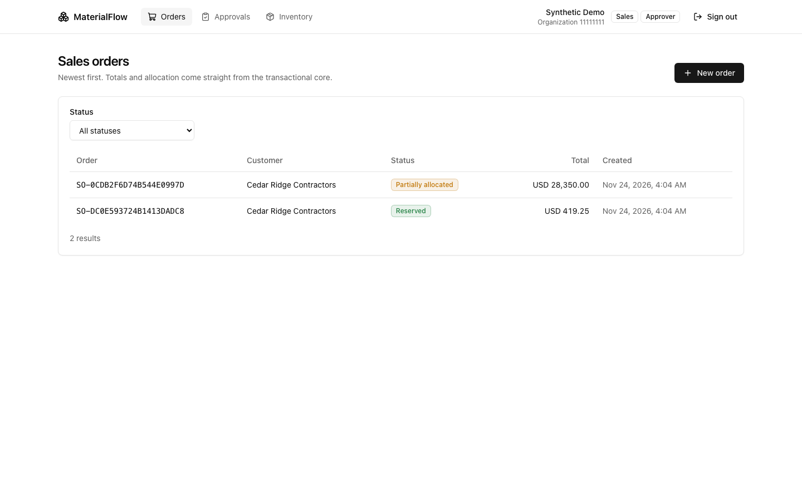
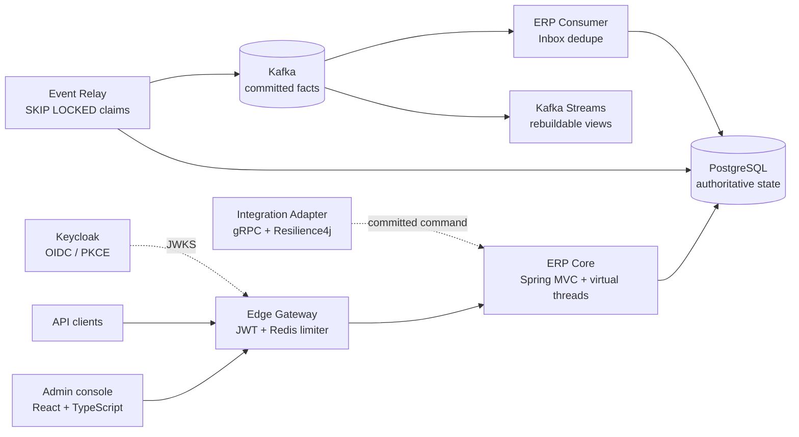

# MaterialFlow ERP

[](https://github.com/simon-jd/materialflow-erp/actions/workflows/ci.yml)
[](https://github.com/simon-jd/materialflow-erp/actions/workflows/admin-console.yml)
[](https://github.com/simon-jd/materialflow-erp/actions/workflows/terraform.yml)
[](https://github.com/simon-jd/materialflow-erp/actions/workflows/fault-matrix.yml)

A Java 21 / Spring Boot 4 order-to-cash backend for a synthetic building-material
distributor, with a React + TypeScript operator console. PostgreSQL is the source
of truth: the inventory debit, the credit reservation, the idempotent order and its
audit and outbox rows commit in one transaction, so the database commit is the
order-success boundary. Kafka, Redis and the read projections are recoverable from
PostgreSQL. The stack runs on Docker Compose, on kind with Helm, on Azure AKS (applied and
verified over public HTTPS) or on AWS from the included Terraform.



## Highlights

Measurements are local runs on an Apple Silicon laptop with synthetic data unless a row
says Azure. Each row links to its evidence folder, which records the method, environment and
raw results.

| Area | What was built | Result |
|---|---|---|
| Crash safety | A 4-window × 5 fault matrix that SIGKILLs the JVM at each boundary of the outbox → Kafka → consumer-inbox path ([evidence](docs/evidence/local-2026-11-23-fault-matrix/README.md)) | 20 of 20 kills recovered. In both consumer windows every run ended with exactly one business effect per event, with redeliveries absorbed by the inbox. |
| Failure detection | Configurable consumer session timeout and optional static membership ([ADR 0011](docs/adr/0011-consumer-failure-detection.md)) | Recovery after a consumer kill went from 45.3 s to 10.7 s at p50, measured over 15 + 15 real kills. |
| Concurrency | A harness comparing pessimistic, optimistic and single-statement reservation on PostgreSQL 17 with virtual threads ([ADR 0008](docs/adr/0008-inventory-reservation-concurrency.md), [evidence](docs/evidence/local-2026-11-23-inventory-concurrency/README.md)) | No oversell in 144 measured runs. A deliberately unguarded control oversold in 48 of 48 runs. On one hot SKU the conditional UPDATE ran at 1.3–1.9× the throughput of `SELECT … FOR UPDATE`; optimistic retries fell behind from 32 workers up. Writing these tests exposed a bug where an order with two lines on the same inventory row always failed with a 409; it is fixed with a regression test. |
| Load | A JMeter hot-SKU test through the JWT gateway and directly against the service | 3,000 measured requests with 0 oversell, 0 duplicate orders and 0 deadlocks; p99 was 559 ms direct and 1,102 ms through the gateway. |
| Full stack | A React 19 + TypeScript console using OIDC PKCE, an OpenAPI-generated client and tenant-scoped paginated reads ([ADR 0010](docs/adr/0010-admin-console.md), [evidence](docs/evidence/local-2026-11-23-admin-console/README.md)) | 64 Vitest tests and 4 Playwright end-to-end tests against the real stack (Keycloak login, maker-checker approval, read-only role enforced by both the UI and the API). |
| Azure environment | Terraform for AKS (Arm64 nodes, Cilium, Gateway API), PostgreSQL Flexible Server 17 on private access, Key Vault with workload identity (no secret in Terraform state), Kafka/Keycloak in the cluster, Let's Encrypt HTTPS, GitHub Actions CD using OIDC ([ADR 0012](docs/adr/0012-azure-aks-deployment.md), [runbook](docs/runbooks/azure-deploy.md), [evidence](docs/evidence/azure-2026-11-24-platform/README.md)) | Applied in westus: 42 Azure resources, 55/55 pods Ready. Over the public HTTPS URL the JWT/RBAC test, the console's 4 Playwright tests and a Kubernetes qualification smoke passed; one order was traced from the API through PostgreSQL, the outbox and Kafka to the consumer inbox (one Jaeger trace across 3 services). |
| Cloud delivery (AWS) | Terraform for ECS Fargate on Graviton, RDS PostgreSQL 17, MSK, Valkey and CloudFront, plus GitHub Actions CD using OIDC ([ADR 0009](docs/adr/0009-aws-ecs-fargate-deployment.md), [runbook](docs/runbooks/aws-deploy.md)) | Validated offline: 17 `terraform test` cases, 0 TFLint issues, 0 unaccepted Trivy findings. Not yet applied to an AWS account; plans require an explicit opt-in. |

## Architecture



The lock order, outbox claim lifecycle and consumer failure policy are described in
[docs/architecture/system.md](docs/architecture/system.md).

## Tech stack

| Layer | Technology |
|---|---|
| Backend | Java 21 (virtual threads), Spring Boot 4.0.8, Spring Security resource server, Spring Cloud Gateway, MyBatis + JDBC on the hot path, Spring Data JPA for master data, Flyway |
| Data and messaging | PostgreSQL 17, Kafka 4.1 (clients and Streams), Redis 8 |
| Integration | gRPC + Protocol Buffers, Resilience4j, OpenAPI 3 contract, JSON Schema event envelope |
| Frontend | React 19, TypeScript (strict), Vite, TanStack Query, react-hook-form + zod, Tailwind CSS, oidc-client-ts |
| Identity | Keycloak (OIDC, Authorization Code + PKCE), tenant and role claims taken only from the signed token |
| Observability | OpenTelemetry, Prometheus with alert-rule tests, Grafana, Jaeger |
| Testing | JUnit 5, Testcontainers, ArchUnit, JMH, JMeter, Vitest + Testing Library + MSW, Playwright |
| Delivery | Docker (non-root, read-only), Helm and kind, Terraform for Azure (AKS) and AWS, cert-manager, GitHub Actions with OIDC, Trivy, gitleaks, CycloneDX SBOM |

## Run locally

```bash
mvn -B -ntp verify
MATERIALFLOW_SECURITY_ENABLED=true docker compose -f deploy/compose/compose.yml --profile console up -d --build
curl http://localhost:8081/actuator/health
```

The console is then at http://localhost:8088. Sign in as one of the synthetic users
listed in [apps/admin-console/README.md](apps/admin-console/README.md). For console
development with hot reload, see that README.

If a default host port is occupied, override it, for example
`MATERIALFLOW_REDIS_PORT=6389 docker compose ...`. The API contract is
[contracts/openapi/materialflow-erp-v1.yaml](contracts/openapi/materialflow-erp-v1.yaml);
all records in the demo migrations are synthetic. Local run details are in
[docs/runbooks/local-development.md](docs/runbooks/local-development.md).

Reproduce the measurements:

- Fault matrix: [tests/failure/README.md](tests/failure/README.md)
- Concurrency harness and JMeter hot-SKU test: [tests/performance/README.md](tests/performance/README.md)
- Azure (AKS) bootstrap, deploy, verify, stop/start and teardown: [docs/runbooks/azure-deploy.md](docs/runbooks/azure-deploy.md)
- AWS bootstrap, deploy, verify and teardown: [docs/runbooks/aws-deploy.md](docs/runbooks/aws-deploy.md)

## Continuous integration and delivery

| Workflow | What it checks |
|---|---|
| [ci](.github/workflows/ci.yml) | Build, unit and Testcontainers integration tests, ArchUnit, Flyway, coverage, Checkstyle and SpotBugs, OpenAPI/Protobuf/JSON Schema lint, Compose and Helm validation, Prometheus alert tests, non-root image builds with a Trivy scan, gitleaks and a CycloneDX SBOM |
| [admin-console](.github/workflows/admin-console.yml) | Generated-client drift check, type check, lint, unit tests, production build and image build |
| [fault-matrix](.github/workflows/fault-matrix.yml) | Drill unit tests and fault-injection overlay validation |
| [terraform](.github/workflows/terraform.yml) | `fmt`, `validate`, `terraform test`, TFLint and Trivy IaC scanning for the AWS and Azure stacks |
| [cd-azure](.github/workflows/cd-azure.yml) | Build and test, push Arm64 images to ACR from a native Arm64 runner, `helm upgrade --install --rollback-on-failure` on AKS and a smoke test through the public URL. Skipped until the Azure deploy identity is configured. |
| [cd-aws](.github/workflows/cd-aws.yml) | Build, push ARM64 images to ECR, roll out ECS services with circuit-breaker rollback, publish the console and smoke-test it. Skipped until an AWS deploy role is configured. |
| [admin-console-e2e](.github/workflows/admin-console-e2e.yml) | Manual Playwright run against the full Compose stack |

## Design decisions

Architecture decision records are in [docs/adr](docs/adr):

1. [Modular transactional core](docs/adr/0001-modular-transactional-core.md)
2. [At-least-once events with Outbox and Inbox](docs/adr/0002-outbox-at-least-once.md)
3. [Consistency, locking and idempotency](docs/adr/0003-consistency-locking-idempotency.md)
4. [Redis failure boundary](docs/adr/0004-redis-failure-boundary.md)
5. [Fence each Outbox claim and make exhausted work terminal](docs/adr/0005-outbox-claim-lifecycle.md)
6. [Preserve recoverable database work at the consumer boundary](docs/adr/0006-consumer-failure-classification.md)
7. [Qualify a supported Spring stack as one runtime change](docs/adr/0007-boot4-runtime-qualification.md)
8. [Inventory reservation under hot-SKU contention](docs/adr/0008-inventory-reservation-concurrency.md)
9. [AWS environment on ECS Fargate with managed data services](docs/adr/0009-aws-ecs-fargate-deployment.md)
10. [Admin console on the existing API](docs/adr/0010-admin-console.md)
11. [Detect a dead domain-event consumer in 10 seconds](docs/adr/0011-consumer-failure-detection.md)
12. [Run the cloud test environment on AKS with managed PostgreSQL](docs/adr/0012-azure-aks-deployment.md)

Operational runbooks are in [docs/runbooks](docs/runbooks).

## Implemented scope

- Modular transactional core for pricing, sales orders, credit, approval,
  inventory, procurement, fulfillment, invoicing, synthetic payment import and
  reconciliation.
- PostgreSQL idempotency, immutable ledgers/audit records, Transactional Outbox,
  Consumer Inbox, reservation expiry and fixed-order credit/inventory locking.
- Consumer failure classification keeps recoverable database work at the source
  with capped backoff, quarantines malformed envelopes, and exposes retry/DLQ
  metrics; real broker/database tests cover offsets and consumer restart.
- Kafka Relay with multi-instance `SKIP LOCKED` claiming, per-claim fencing,
  exhausted-lease recovery, bounded retry and dead lettering; Kafka Streams
  rebuildable projections.
- Reactive Gateway with optional Keycloak JWT validation, Redis rate limiting and
  fail-closed sensitive writes; Protocol Buffers/gRPC synthetic integrations with
  Resilience4j.
- Compose, Helm, OpenTelemetry, Prometheus, Grafana, Jaeger, CI gates, JMH and
  JMeter workloads.
- React + TypeScript admin console over tenant-scoped read endpoints, signed in
  with OIDC Authorization Code + PKCE.
- Terraform for an Azure environment (AKS, PostgreSQL Flexible Server, Key Vault, ACR) that is
  applied and verified, with a Helm-based GitHub Actions CD pipeline using OIDC.
- Opt-in Terraform for an AWS environment (ECS Fargate, RDS, MSK, Valkey,
  CloudFront) and a GitHub Actions CD pipeline that authenticates through OIDC.

## Verification history

This is a portfolio-scale reference implementation, not a production ERP. Claims
in `docs/evidence` distinguish `measured`, `derived`, `estimated`, and `unknown`.
No production SLA or unmeasured throughput is claimed.

The 2026-11-23 evidence sets ([fault matrix](docs/evidence/local-2026-11-23-fault-matrix/README.md),
[inventory concurrency](docs/evidence/local-2026-11-23-inventory-concurrency/README.md),
[admin console](docs/evidence/local-2026-11-23-admin-console/README.md),
[AWS IaC validation](docs/evidence/local-2026-11-23-aws-iac/README.md)) are new local runs and are
kept separate from the earlier snapshots below. The
[Azure platform evidence](docs/evidence/azure-2026-11-24-platform/README.md) (2026-11-24) is the
first run in a real cloud environment.

The 2026-09-01 local verification index is
[`docs/evidence/local-2026-09-01/README.md`](docs/evidence/local-2026-09-01/README.md).
The formal three-run long-duration performance protocol, JWT/RBAC and tenant
isolation checks, kind Pod/rolling-update drills, and one complete
API-to-database-to-Outbox-to-Kafka-consumer trace are now locally verified. The
implementation remains an `implemented_local_reference`, not evidence of real
production tenure, customers, team ownership, cloud SLA, or past employment.
The [2026-09-06 reliability update](docs/evidence/local-2026-09-06/README.md)
adds verified Relay recovery and transactional consumer-metric fixes. It records
current tests separately from the historical performance/deployment baseline.
The corresponding Experience/Evidence Bank entries were authorized by the user
for this update; their synchronization record is in the new evidence index.
The [2026-09-07 consumer update](docs/evidence/local-2026-09-07/README.md)
adds database-outage retry classification and actual consumer-offset recovery
tests. Its [decision record](docs/adr/0006-consumer-failure-classification.md)
explains partition blocking and retained at-least-once delivery; the
[consumer runbook](docs/runbooks/consumer-recovery.md) covers diagnosis and replay.

The runtime now uses Spring Boot 4.0.8 / Cloud 2025.1.2, Jackson 3, MyBatis Starter
4.0.1 and Resilience4j 2.4.0 on Java 21. Tomcat 11.0.25 addresses the published
August advisories; Protobuf compiler/runtime 4.33.5 resolves an observed OTel
startup incompatibility. PostgreSQL 17.11 and Kafka 4.1.2 are the selected local
runtime patches. The [migration decision](docs/adr/0007-boot4-runtime-qualification.md)
records benefits, compatibility costs and rollback limits.

The [runtime qualification index](docs/evidence/local-2026-09-07-qualification/README.md)
separates current container/test/measurement results from all earlier snapshots.
Use the [qualification runbook](docs/runbooks/runtime-qualification.md) for the
isolated JWT-enabled Compose stack, exact-JAR image packaging, bounded JMeter
protocol and actual process-kill drills. These remain local synthetic experiments.

## Earlier results (cloud-hosted test environment)

The results below are the owner-confirmed results from a separate cloud-hosted test environment, synchronized from the Experience Bank. The experiments retain the local, synthetic, simulator, CPU, Docker and single-host boundaries stated in each result; cloud hosting does not imply production deployment. This repository refresh does not represent a rerun of those measurements. Earlier dated evidence below remains tied to its own source, configuration and denominator.

1. Built a simulated Java 21/Spring Boot 4.0.8 ERP backend on PostgreSQL 17.6 where inventory debit, credit reservation, the idempotent order and audit/outbox records commit together and the database commit is the order-success boundary; the 60-case suite splits into 20 order-transaction, 18 relay (including 8 component-scenario designs, which are not added on top of the 18), 12 consumer and 10 configuration-migration cases.

2. Fenced every relay claim with a per-claim random claim_token on the outbox completion UPDATE (batch 50, 30 s lease, recovery of 100 rows per second), so a worker that revives after lease expiry cannot overwrite a newer claimant's completion.

3. Absorbed at-least-once delivery downstream with an inbox(event_id) unique key in the same transaction as the business update: 1,200 Kafka deliveries (the 1,000 order events plus 200 duplicate publishes) produced 1,000 inbox rows and exactly 1,000 business updates with 200 duplicates recognized, while the 1,000 order submissions that were each re-sent once were absorbed by the order idempotency key.

4. Covered the four fault windows with 20 simulated kills (4 windows x 5 each) in a separate fixture that does not change the 1,200-delivery denominator: the inbox-insert-uncommitted and inbox-committed/offset-uncommitted windows still converge to one business update, the post-Kafka-ACK window allows multiple messages with the same event_id, and after a DLQ ACK the DLQ may repeat while the source offset eventually advances.

5. Kept failure handling explicit: permanently invalid events go to a DLQ, database lock timeouts back off, and at the backoff cap the offset is not advanced and an alert fires instead of silently dropping orders.

6. Recorded capped-rate latency comparisons of 3 rounds x 180 s x 10 requests/s = 5,400 requests per version with the HTTP-receive-to-order-commit endpoint and the outbox.created_at-to-downstream-commit event latency recorded separately; the equal arrival rate supports no throughput-improvement claim. The five-app topology (100 SKUs, 1,000 customers, one order line and amount 100 per order) runs on an 8-core/16 GiB local Docker host with Kafka clients/Streams 4.1.2, and health, JWT, gRPC and tracing connectivity is a separate acceptance denominator from the 60 JUnit cases.

See the [implementation and reproduction map](docs/experience-bank-alignment.md) for per-result source/tests, reproduction commands and limitations.

Result 4 describes the fault-matrix design. On 2026-11-23 the same four windows were run with real process kills; those results are in [Highlights](#highlights) and kept as a separate evidence set.

## Privacy

All organizations, users, materials, prices, accounts, and transactions are
synthetic. The owner has authorized publication to this GitHub repository. Runtime credentials and private local state are excluded from publication.
