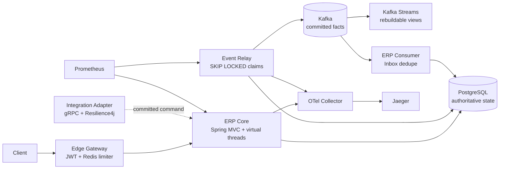

# MaterialFlow architecture

PostgreSQL is the sole authority. Redis can disappear and Kafka can stop without
changing committed ERP facts. The core transaction writes the aggregate,
idempotency record, audit entry and Outbox record together; publication and every
network integration happen after commit.

The consistent lock order for allocate, ship, cancel and expiry is customer
credit first, followed by inventory balances sorted by warehouse, material and
location. Kafka offsets advance after the Inbox transaction succeeds or a
non-recoverable record reaches acknowledged consumer DLQ quarantine. Transient
database failures retain source replay with capped retry delay; see
[consumer failure classification](../adr/0006-consumer-failure-classification.md).
Projection state is disposable and never answers a credit or stock decision.

The five runtimes use the coordinated Boot 4.0 / Cloud 2025.1 dependency family;
the [migration ADR](../adr/0007-boot4-runtime-qualification.md) records Jackson,
instrumentation and gRPC compatibility decisions. The [qualification runbook](../runbooks/runtime-qualification.md)
packages tested JARs into isolated Compose applications and distinguishes actual
process death from injected in-JVM failures. PostgreSQL commit, broker ACK and
source offset commit remain separate boundaries across this migration.

Runtime ownership:

| Runtime | Owns | Must not own |
|---|---|---|
| `erp-core` | business state and transactions | external network calls in a DB transaction |
| `event-relay` | claim/publish/retry status | business aggregate mutation |
| `edge-gateway` | auth, routing, shared throttling | ERP tables |
| `stream-projection` | rebuildable read state | authoritative decisions |
| `integration-adapter` | synthetic external protocols | internal module RPC |
