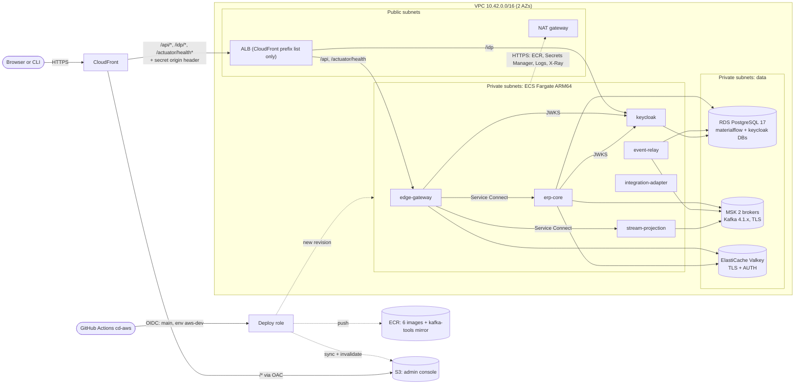

# AWS dev environment: bootstrap, deploy, verify, teardown

The environment in `deploy/terraform/aws` runs the five applications and Keycloak on ECS Fargate
(ARM64) behind CloudFront, with RDS PostgreSQL 17, Amazon MSK and ElastiCache Valkey. The
`cd-aws` workflow builds, pushes and deploys it from `main`. Design reasons are in
[ADR 0009](../adr/0009-aws-ecs-fargate-deployment.md).

> **Status: not yet applied.** Everything here is validated offline (see
> [what has and has not been validated](#validated-so-far-vs-not-yet-applied)). Every command that
> touches AWS below is for the owner to run deliberately; each one creates or deletes billable
> resources (about $9/day while up).

## Architecture



Each task also runs an OpenTelemetry collector sidecar (ADOT) that forwards the application's
OTLP traces to X-Ray (10% sampling by default). Logs go to `/ecs/materialflow-dev/<service>`.

## Prerequisites

- Terraform >= 1.10 (validated with 1.17.2), AWS CLI v2, `gh`, `jq`, and an AWS account where you
  may create IAM roles. Credentials are only needed by the person running Terraform.
- Admin rights on the GitHub repository (variables, environments, OIDC subject template).

## Bootstrap (one time)

1. **State bucket.** Keep state outside the stack so `terraform destroy` never deletes it:

   ```bash
   bucket=materialflow-tfstate-<account-id>
   aws s3api create-bucket --bucket "$bucket" --region us-east-1
   aws s3api put-bucket-versioning --bucket "$bucket" --versioning-configuration Status=Enabled
   aws s3api put-public-access-block --bucket "$bucket" --public-access-block-configuration \
     BlockPublicAcls=true,IgnorePublicAcls=true,BlockPublicPolicy=true,RestrictPublicBuckets=true
   ```

2. **Local configuration** (both files are git-ignored):

   ```bash
   cd deploy/terraform/aws
   cp backend.hcl.example backend.hcl     # set bucket; use_lockfile = true locks state in S3
   cp dev.tfvars.example dev.tfvars       # set aws_account_id; enable_aws = true is the opt-in
   terraform init -backend-config=backend.hcl
   ```

3. **GitHub OIDC subject.** GitHub's default subject for a job in an environment omits the branch.
   Include it so the deploy role can require both `environment:aws-dev` and `refs/heads/main`:

   ```bash
   gh api --method PUT repos/simon-jd/materialflow-erp/actions/oidc/customization/sub \
     --input - <<< '{"use_default": false, "include_claim_keys": ["repo", "context", "ref"]}'
   ```

   Subjects then look like `repo:simon-jd/materialflow-erp:environment:aws-dev:ref:refs/heads/main`
   (`terraform output github_oidc_subject` prints the exact value the role trusts). Also create the
   `aws-dev` environment (Settings → Environments) and restrict its deployment branches to `main`;
   required reviewers are optional.

4. **First apply: everything except the ECS services.** Leave `bootstrap_image_tag` unset; there
   are no images yet, and services are only created once there are.

   ```bash
   terraform plan -var-file=dev.tfvars -out=bootstrap.tfplan
   terraform apply bootstrap.tfplan       # MSK takes 15-30 min, CloudFront several minutes
   ```

5. **Repository variables** for the workflow (repository level, because the job-level gate reads
   `AWS_DEPLOY_ROLE_ARN` before any environment is entered):

   ```bash
   terraform output -json github_actions_variables |
     jq -r 'to_entries[] | "\(.key)\t\(.value)"' |
     while IFS=$'\t' read -r key value; do gh variable set "$key" --body "$value"; done
   ```

6. **Push the first images** without deploying: Actions → `cd-aws` → Run workflow on `main` with
   `images_only` checked. It runs the tests, pushes the five application images and Keycloak
   tagged with the commit SHA, and mirrors `apache/kafka` into `kafka-tools`.

7. **Second apply: create the services** with that SHA:

   ```bash
   terraform apply -var-file=dev.tfvars -var bootstrap_image_tag=<commit-sha>
   ```

   Put the SHA into `dev.tfvars` so later applies keep it. From now on the pipeline decides which
   image runs: Terraform uses this tag only for task definition revisions it creates itself, and
   `cd-aws` always swaps in the commit's image.

## Deploy (every push to main)

`cd-aws` runs these jobs; each needs the previous one to succeed:

1. **Build and test:** `mvn -B -ntp verify`; the five tested JARs are uploaded as an artifact.
2. **Images:** `linux/arm64` images from `Dockerfile.runtime` with exactly those JARs, plus
   Keycloak. Only the image stages run under QEMU (`apk` for the apps, `kc.sh build` for Keycloak);
   nothing is compiled twice. Tags are the commit SHA and immutable; images already pushed by an
   earlier attempt are skipped.
3. **Deploy core:** Keycloak and erp-core in parallel. erp-core runs Flyway, so it must be healthy
   before the services that read its schema roll out.
4. **Deploy services:** event-relay, stream-projection, integration-adapter, edge-gateway.
   Each deploy renders the newest task definition revision of the family with the new image,
   registers it and waits for the service to be stable.
5. **Console:** if `apps/admin-console` exists, `npm ci && npm run build`, write `config.js`,
   upload hashed assets (cached one year), then `config.js` and `index.html` (`no-cache`), and
   invalidate those two paths.
6. **Smoke test:** `tests/deployment/aws-smoke.sh` through CloudFront.

The `cd-aws-dev` concurrency group runs one deployment at a time without cancelling a rollout.

**Rollback.** Each service has the ECS deployment circuit breaker with rollback: if new tasks never
pass their health checks, ECS returns to the previous revision and the workflow fails. To roll back
a deployment that is healthy but wrong, point the service at an earlier revision:

```bash
aws ecs list-task-definitions --family-prefix materialflow-dev-erp-core --sort DESC --max-items 3
aws ecs update-service --cluster materialflow-dev --service erp-core \
  --task-definition materialflow-dev-erp-core:<revision>
```

Database migrations are forward-only (see [migrations and rollback](migrations-and-rollback.md));
rolling back erp-core past a migration needs the same care as locally.

**Terraform changes to a task definition** (environment, CPU, memory) create a new revision that
the next `cd-aws` run picks up; run the workflow manually to ship them without a code change.

## Verify

```bash
url=$(terraform output -raw public_url)
MATERIALFLOW_PUBLIC_URL="$url" bash tests/deployment/aws-smoke.sh
```

The smoke test is read-only. It checks gateway health through CloudFront, obtains a token for the
synthetic demo user from Keycloak at `/idp`, checks that the token's issuer is the public URL,
expects 401 for an unauthenticated order read, and 404 `RESOURCE_NOT_FOUND` for an authenticated
read of a random order ID (the JWT passed the gateway and erp-core, Service Connect routed the call
and PostgreSQL answered). With `SMOKE_CONSOLE=true` it also checks a console deep link and
`config.js`.

Further checks:

```bash
aws ecs describe-services --cluster materialflow-dev --services erp-core \
  --query 'services[0].{running:runningCount,rollout:deployments[0].rolloutState,events:events[:3]}'
aws logs tail /ecs/materialflow-dev/erp-core --since 15m --follow
# The ALB itself is unreachable except from CloudFront: this should time out.
curl -m 5 -sS "http://$(terraform output -raw alb_dns_name)/api/v1/orders/x" || echo "ALB not reachable directly (expected)"
```

Traces appear in CloudWatch → X-Ray traces (service names `materialflow-*`).

## Operations notes

- **RDS secret rotation.** RDS rotates the managed master secret every 7 days. Running tasks keep
  the password they started with, so after a rotation run `cd-aws` (or
  `aws ecs update-service --force-new-deployment`) for erp-core, event-relay and keycloak.
- **Pausing.** `service_overrides = { "erp-core" = { desired_count = 0 }, ... }` stops tasks, but
  RDS, MSK, ElastiCache, NAT and the ALB keep billing (about $0.22/hour). Destroy instead of pausing
  for more than a few hours.
- **Keycloak administration** is not exposed (`/idp/admin` and the master realm return 404 at the
  ALB). The realm is declarative; change `deploy/compose/keycloak/materialflow-realm.json`. An
  existing realm is not re-imported, so realm changes need a fresh `keycloak` database.
- **Synthetic credentials.** The realm's demo users and passwords are public in this repository.
  Keep the environment up only for demonstrations.

## Teardown

```bash
# 1. Lift deletion protection (the only setting that blocks destroy) and apply it.
terraform apply -var-file=dev.tfvars -var postgres_deletion_protection=false
# 2. Destroy everything in the stack.
terraform destroy -var-file=dev.tfvars -var postgres_deletion_protection=false
```

What to expect:

| Resource | Behavior on destroy |
|---|---|
| RDS | Blocked while `postgres_deletion_protection = true`. Otherwise a final snapshot `materialflow-dev-final` is taken (unless `postgres_skip_final_snapshot = true`); it is retained and billed until you delete it, and a second destroy fails while a snapshot with that name exists. |
| ECR repositories, console bucket | Deleted with their contents (`force_destroy_artifacts = true`); set it false to make destroy refuse instead. |
| Secrets (Valkey AUTH, Keycloak admin) | Scheduled for deletion with a 7-day recovery window; names use a prefix, so an immediate re-create does not collide. The RDS-managed secret is deleted with the instance. |
| KMS key | Scheduled for deletion after 7 days (`aws kms cancel-key-deletion` restores it). |
| CloudFront | Disabled and deleted by Terraform; this takes several minutes. |
| GitHub OIDC provider | Deleted if this stack created it (`create_github_oidc_provider = true`). |
| State bucket, GitHub variables | Not managed by this stack; delete them by hand if no longer needed. |

After destroy, `aws resourcegroupstaggingapi get-resources --tag-filters Key=Project,Values=materialflow`
should list nothing but the retained snapshot and resources pending deletion (KMS key, secrets).

## Cost estimate

**Estimated**, not measured: derived on 2026-11-23 from public on-demand list prices for
us-east-1 for the default configuration, excluding taxes, free-tier credits and data transfer
beyond the noted usage assumptions. Verify in the AWS Pricing Calculator before applying; nothing
has been billed.

| Component | Sizing | Unit price | $/hour | $/month (730 h) |
|---|---|---|---:|---:|
| Fargate ARM64 vCPU | 4 vCPU (erp-core 1, keycloak 1, four services 0.5) | $0.03238 per vCPU-hour | 0.1295 | 94.55 |
| Fargate ARM64 memory | 8 GB (2 + 2 + 4 × 1) | $0.00356 per GB-hour | 0.0285 | 20.79 |
| MSK brokers | 2 × kafka.t3.small | $0.0456 per broker-hour ¹ | 0.0912 | 66.58 |
| MSK storage | 2 × 10 GB | $0.10 per GB-month | 0.0027 | 2.00 |
| RDS PostgreSQL | db.t4g.micro, Single-AZ | $0.016 per hour ² | 0.0160 | 11.68 |
| RDS storage | 20 GB gp3 | $0.115 per GB-month | 0.0032 | 2.30 |
| ElastiCache Valkey | 1 × cache.t4g.micro | $0.0128 per hour ² | 0.0128 | 9.34 |
| NAT gateway | 1 (single) | $0.045 per hour + $0.045/GB | 0.0450 | 32.85 |
| Application Load Balancer | 1, near-idle | $0.0225 per hour + $0.008/LCU-hour | 0.0225 | 16.43 |
| Public IPv4 addresses | NAT EIP + 2 ALB nodes | $0.005 per address-hour | 0.0150 | 10.95 |
| CloudWatch Logs | assumed 0.25 GB/day ingested | $0.50 per GB | 0.0051 | 3.75 |
| Secrets Manager | 3 secrets | $0.40 per secret-month | 0.0016 | 1.20 |
| KMS | 1 customer-managed key | $1 per key-month | 0.0014 | 1.00 |
| CloudFront, X-Ray, ECR, S3 | demo traffic, 10% trace sampling | within free tiers / < $1 | ~0 | ~1 |
| **Total (default)** | | | **≈ 0.375** | **≈ 275** |

¹ Not confirmed on the AWS page during this session (its instance table is rendered client-side);
from the published MSK price list as last known. ² From the AWS price list as reported by
third-party trackers; the Valkey rate is 20% below the Redis OSS rate.

Options and their effect: one NAT gateway per AZ +$0.050/hour; interface endpoints (4 services × 2
AZs) +$0.080/hour, which only pays off above roughly 1.7 TB/month of NAT traffic; Multi-AZ RDS
+$0.016/hour; Container Insights adds CloudWatch custom metrics per service and task. An EKS
control plane, by comparison, would add $0.10/hour on its own.

## Validated so far vs not yet applied

Validated without an AWS account (details and reproduction in the
[evidence](../evidence/local-2026-11-23-aws-iac/README.md)):

- `terraform fmt`, `init -backend=false`, `validate` with Terraform 1.17.2 and AWS provider 6.74.0.
- 17 `terraform test` runs with mocked providers: the `enable_aws` gate, input validation, service
  gating on `bootstrap_image_tag`, issuer and OIDC subject values, the security-group flow table,
  NAT and endpoint toggles, task memory budgets, init-container ordering and deployment settings.
- TFLint 0.66.0 with the AWS ruleset 0.50.0 (all Terraform rules): no issues. Trivy 0.76.2 config
  scan: no unaccepted findings; 8 checks accepted with inline reasons (14 raw findings).
- actionlint 1.7.12 (with shellcheck) on both workflows; shellcheck on the shell scripts.
- All five application images and the Keycloak image build for `linux/arm64`, both from the
  multi-stage Dockerfile and from tested JARs with `Dockerfile.runtime` (JAR hashes match).
- The Keycloak image, its database init script, `/idp` path, management health on :9000, token
  claims and issuer, in-network JWKS URL and import idempotency, against a local PostgreSQL; the
  admin console redirect-URI placeholder against that branch's realm.
- The topic init script against a local Kafka 4.1.2 broker (twice), and the trace collector
  configuration in the ADOT 0.51.0 image.
- Keycloak behind an HTTP hop: discovery keeps the public URL under a foreign Host header, and
  cookies are `Secure` only with CloudFront's `Forwarded: proto=https` header (which is now sent).
- A local end-to-end run with nginx standing in for CloudFront/ALB path routing: the ECS health
  check command passes in the real images and `tests/deployment/aws-smoke.sh` passes (401 without
  a token, 404 `RESOURCE_NOT_FOUND` with one).

Not yet applied or exercised (needs an AWS account):

- `terraform plan`/`apply`: provider-side validation, real resource names and quotas, MSK/RDS/
  ElastiCache engine-version and instance-class availability in the chosen region.
- GitHub OIDC role assumption with the customized subject, ECR pushes, ECS deployments and the
  circuit breaker, Service Connect resolution, RDS/MSK/Valkey TLS from the JVMs, the RDS secret
  rotation behavior, X-Ray trace delivery, CloudFront routing and the smoke test against AWS.
- Real costs.
