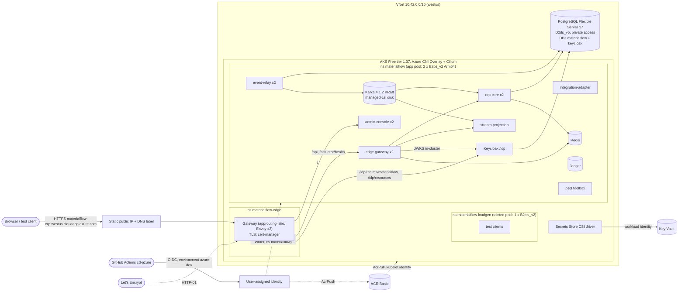

# Azure AKS dev environment: bootstrap, deploy, verify, stop/start, teardown

The environment in `deploy/terraform/azure` runs the five services, the admin console, Kafka,
Redis, Keycloak and Jaeger on AKS (Arm64 nodes), with PostgreSQL 17 on Azure Database for
PostgreSQL Flexible Server, behind one public HTTPS origin. Design reasons are in
[ADR 0012](../adr/0012-azure-aks-deployment.md); the first bring-up is recorded in the
[platform evidence](../evidence/azure-2026-11-24-platform/README.md).

> It is billable while it runs (about $0.53/hour, see [Cost](#cost)). Stop it when idle and destroy
> it when the tests are done.

## Architecture



| Item | Value |
|---|---|
| Public URL | `https://materialflow-erp.westus.cloudapp.azure.com` (console `/`, API `/api`, Keycloak `/idp`) |
| Resource groups | `rg-materialflow-dev` (everything Terraform creates), `rg-materialflow-dev-nodes` (AKS-managed: VMs, disks, load balancer) |
| Cluster | `aks-materialflow-dev`, Entra ID + Azure RBAC, local accounts disabled |
| Namespaces | `materialflow` (apps, data services), `materialflow-edge` (Gateway, certificate), `materialflow-loadgen` (test clients), `cert-manager` |
| Helm releases | `materialflow-platform` (operator), `materialflow` (cd-azure), `cert-manager` (operator) |

## Prerequisites

- Terraform >= 1.11 (validated with 1.17.2), Azure CLI >= 2.86, kubectl and kubelogin
  (`az aks install-cli`), Helm 4 (validated with 4.3.2), Docker with Buildx for `linux/arm64`
  images (an Arm64 machine builds them natively), `jq`.
- Owner (or Contributor + User Access Administrator) on the subscription: Terraform creates role
  assignments.

## Bootstrap (one time)

All commands run from the repository root unless noted. `KUBECONFIG` points at a dedicated file so
the operator's default kubeconfig is never touched.

```bash
export ARM_SUBSCRIPTION_ID=<subscription-id>        # also passed explicitly in dev.tfvars
export KUBECONFIG=$HOME/materialflow-azure/kubeconfig
mkdir -p ~/materialflow-azure/state && chmod 700 ~/materialflow-azure ~/materialflow-azure/state
```

1. **Check capacity** (the subscription may not be offered every size; this is why the nodes are Arm64):

   ```bash
   az vm list-usage -l westus --subscription "$ARM_SUBSCRIPTION_ID" -o table | grep -E 'Total Regional|Bpsv2'
   az rest --method get --url "https://management.azure.com/subscriptions/$ARM_SUBSCRIPTION_ID/providers/Microsoft.Compute/skus?api-version=2021-07-01&\$filter=location%20eq%20'westus'" \
     | jq -r '.value[] | select(.name=="Standard_B2ps_v2" or .name=="Standard_B2pls_v2") | "\(.name) restrictions=\(.restrictions|length)"'
   ```

2. **Terraform.** `dev.tfvars` is git-ignored; copy the example and set the subscription and the
   public IPv4 address of the machine that runs Terraform (Key Vault firewall).

   ```bash
   cd deploy/terraform/azure
   cp dev.tfvars.example dev.tfvars
   terraform init -backend-config="path=$HOME/materialflow-azure/state/terraform.tfstate"
   terraform fmt -check -recursive && terraform validate
   tflint --init && tflint --recursive --config "$PWD/.tflint.hcl"
   trivy config --skip-dirs .terraform --exit-code 1 .
   terraform plan -var-file=dev.tfvars -out=$HOME/materialflow-azure/state/apply.tfplan
   terraform apply $HOME/materialflow-azure/state/apply.tfplan   # about 15 minutes
   terraform output -raw helm_environment_values > ~/materialflow-azure/environment-values.yaml
   eval "$(terraform output -raw get_credentials_command)"
   cd -
   ```

3. **Images** for the first release (later releases come from `cd-azure`). Package the tested JARs,
   then build `linux/arm64` images and push them with a short-lived ACR token:

   ```bash
   mvn -B -ntp verify
   ACR=$(terraform -chdir=deploy/terraform/azure output -raw acr_login_server); TAG=<tag>
   az acr login -n "${ACR%%.*}"
   bash tests/deployment/build-runtime-images.sh "$TAG"     # or the loop in cd-azure.yml
   for app in erp-core event-relay edge-gateway stream-projection integration-adapter; do
     docker tag "materialflow-qualification/$app:$TAG" "$ACR/materialflow/$app:$TAG"
     docker push "$ACR/materialflow/$app:$TAG"
   done
   docker buildx build --platform linux/arm64 --push -t "$ACR/materialflow/admin-console:$TAG" apps/admin-console
   docker buildx build --platform linux/arm64 --push -f deploy/docker/Dockerfile.keycloak -t "$ACR/materialflow/keycloak:$TAG" .
   # Third-party images are mirrored into the registry (no Docker Hub pulls from the nodes):
   for src in apache/kafka:4.1.2 library/redis:8.2.1-alpine jaegertracing/jaeger:2.10.0 library/postgres:17.11-alpine; do
     az acr import -n "${ACR%%.*}" --source "docker.io/$src" --image "mirror/${src#library/}" --force
   done
   ```

4. **cert-manager, platform, application:**

   ```bash
   helm upgrade --install cert-manager oci://quay.io/jetstack/charts/cert-manager --version v1.21.3 \
     -n cert-manager --create-namespace -f deploy/kubernetes/aks/cert-manager-values.yaml --wait
   kubectl create namespace materialflow
   # letsencrypt-staging first if the DNS name or port 80 path is new; then letsencrypt-prod.
   helm upgrade --install materialflow-platform deploy/kubernetes/aks/platform -n materialflow \
     -f ~/materialflow-azure/environment-values.yaml --set keycloak.imageTag="$TAG" \
     --set tls.issuer=letsencrypt-prod --timeout 12m
   kubectl -n materialflow-edge wait --for=condition=Ready certificate/materialflow-tls --timeout=5m
   helm upgrade --install materialflow deploy/helm/materialflow -n materialflow \
     -f deploy/helm/materialflow/values-aks.yaml -f ~/materialflow-azure/environment-values.yaml \
     --set global.imageTag="$TAG" --rollback-on-failure --wait --timeout 12m
   ```

5. **GitHub** (repository admin). Create the `azure-dev` environment (restrict it to `main` if
   wanted) and set the variables from `terraform output -json github_actions_variables`
   (`AZURE_CLIENT_ID`, `AZURE_TENANT_ID`, `AZURE_SUBSCRIPTION_ID`, `AKS_RESOURCE_GROUP`,
   `AKS_CLUSTER_NAME`, `ACR_NAME`, `MATERIALFLOW_PUBLIC_URL`, `AKS_HELM_VALUES`). None is secret.
   `AZURE_CLIENT_ID` must be a repository variable: the job-level gate reads it before any
   environment is entered. The federated credential trusts exactly
   `repo:simon-jd/materialflow-erp:environment:azure-dev` (`terraform output github_oidc_subject`).

## Deploy (every push to main)

`cd-azure` runs three jobs: `mvn -B -ntp verify` and upload of the five tested JARs; `linux/arm64`
images built on a native Arm64 runner from exactly those JARs plus the console, tagged with the
commit SHA and pushed with an OIDC login (AcrPush only); `helm upgrade --install` of the
application chart with `--rollback-on-failure` (Helm 4's name for `--atomic`), then
`tests/deployment/aws-smoke.sh` against the public URL (gateway health, Keycloak token whose
issuer is the public URL, 401 without a token, 404 `RESOURCE_NOT_FOUND` with one, console deep
link and `config.js`). The deploy identity can write ordinary objects in `materialflow` only; the
platform chart, Gateway and certificates are an operator change.

Rollback of a healthy but wrong release: `helm -n materialflow rollback materialflow <revision>`.

## Verify

```bash
H=https://materialflow-erp.westus.cloudapp.azure.com
kubectl get pods -A                                     # all Running/Ready
MATERIALFLOW_PUBLIC_URL=$H SMOKE_CONSOLE=true bash tests/deployment/aws-smoke.sh
MATERIALFLOW_GATEWAY_URL=$H MATERIALFLOW_KEYCLOAK_URL=$H/idp bash tests/security/jwt-rbac-e2e.sh
python3 tests/deployment/k8s-qualification-smoke.py --public-url $H --order-id <id from the line above> --output /tmp/q.json
(cd apps/admin-console && npm ci && E2E_BASE_URL=$H npx playwright test e2e/admin-console.spec.ts)
kubectl -n materialflow exec deploy/materialflow-toolbox -- psql -c 'select version, success from flyway_schema_history'
```

**Getting a JWT** (synthetic users from `deploy/compose/keycloak/materialflow-realm.json`):

```bash
TOKEN=$(curl -fsS "$H/idp/realms/materialflow/protocol/openid-connect/token" \
  -d client_id=materialflow-cli -d grant_type=password \
  -d username=synthetic-demo -d password=synthetic-demo-only | jq -r .access_token)
curl -fsS -H "Authorization: Bearer $TOKEN" "$H/api/v1/orders?size=5"
```

Access tokens live 2 hours (`accessTokenLifespan: 7200` in the realm). `synthetic-sales` is a maker, `synthetic-demo` has every
role, `synthetic-readonly` has none, `synthetic-other-tenant` belongs to another organization.

**Inside the cluster.** Services: `materialflow-erp-core:8080`, `materialflow-edge-gateway:8081`,
`materialflow-stream-projection:8082`, `materialflow-integration-adapter:8083` (gRPC 9090),
`materialflow-event-relay:8084`, `materialflow-admin-console:8080`, `keycloak:8080` (management
9000), `kafka:9092`, `redis:6379`, `jaeger:16686` (OTLP 4318). The default-deny NetworkPolicy
admits only pods labelled `app.kubernetes.io/part-of=materialflow`, the Gateway namespace and
the `materialflow-loadgen` namespace. Test clients go to `materialflow-loadgen` with
`nodeSelector: {workload: loadgen}` and a toleration for `workload=loadgen:NoSchedule`.

```bash
kubectl -n materialflow exec deploy/materialflow-toolbox -- psql                 # admin psql over TLS
kubectl -n materialflow exec kafka-0 -- /opt/kafka/bin/kafka-console-consumer.sh \
  --bootstrap-server kafka:9092 --topic materialflow.domain-events.v1 --from-beginning --timeout-ms 10000
kubectl -n materialflow port-forward deploy/jaeger 16686    # traces; port-forward bypasses NetworkPolicy
```

## Fault drills

`faultInjection.enabled=true` (application chart) gives erp-core and event-relay
`shareProcessNamespace: true` and runs erp-core with the `fault-injection` Spring profile
(`ConsumerCrashWindowGate`). Enable it only for a drill:

```bash
helm upgrade materialflow deploy/helm/materialflow -n materialflow --reuse-values --set faultInjection.enabled=true --wait
POD=$(kubectl -n materialflow get pod -l app.kubernetes.io/name=materialflow-erp-core -o name | head -1)
kubectl -n materialflow exec "$POD" -- sh -c 'kill -KILL $(pidof java)'     # container restarts in place
```

The kubelet restarts a killed container immediately the first time. After that it waits until the
current crash back-off has passed since the container exited (10 s, doubling to 300 s), however long
the container ran in between; the back-off resets only when 10 minutes pass between two exits of the
same container (measured in the [fault-matrix evidence](../evidence/azure-2026-11-24-fault-matrix/README.md):
successive kills of one pod restarted after 0.5, 10, 23 and 55 s; another pod, killed 11 times in
53 minutes, reached 302–325 s). Recovery with two replicas did not depend on it. Record restart delay
separately from recovery, as the matrix does. Turn the switch off afterwards
(`--set faultInjection.enabled=false`).

The full process-kill matrix (`tests/failure/process-kill-recovery.py --backend kubernetes`) and
the zero-downtime drill (`tests/failure/kubernetes-zero-downtime.sh`) are described in
[tests/failure/README.md](../../tests/failure/README.md); the load and contention tests in
[tests/performance/README.md](../../tests/performance/README.md#running-on-aks). Run them one at a
time: the cluster has no spare capacity. See [Cloud tests](#cloud-tests) for the order and the
results.

## Reset synthetic data

The Playwright suite and the drills assume freshly seeded data (for example, stock that the
approval test allocates). To start over, recreate the application database; erp-core re-runs the
Flyway migrations, including the synthetic seed, when it starts:

```bash
kubectl -n materialflow scale deploy materialflow-erp-core materialflow-event-relay --replicas=0
kubectl -n materialflow exec deploy/materialflow-toolbox -- psql -d postgres -c 'DROP DATABASE materialflow WITH (FORCE)'
kubectl -n materialflow exec deploy/materialflow-toolbox -- psql -d postgres \
  -c "CREATE DATABASE materialflow ENCODING 'UTF8' LC_COLLATE 'en_US.utf8' LC_CTYPE 'en_US.utf8' TEMPLATE template0"
kubectl -n materialflow scale deploy materialflow-erp-core materialflow-event-relay --replicas=2
kubectl -n materialflow rollout status deploy/materialflow-erp-core
```

Kafka keeps the old events and the consumer groups keep their committed offsets, so old events
are not reprocessed; the stream projection keeps aggregates of the old orders (harmless).

## Stop and start (save credit)

Stopping deallocates the VMs and the database compute; disks, IPs, the registry and Key Vault keep
billing (about $0.05/hour). Do this whenever the environment will be idle for more than an hour.

```bash
S=--subscription=$ARM_SUBSCRIPTION_ID
az aks stop $S -g rg-materialflow-dev -n aks-materialflow-dev
az postgres flexible-server stop $S -g rg-materialflow-dev -n "$(terraform -chdir=deploy/terraform/azure output -raw postgres_server_name)"
# later
az postgres flexible-server start $S -g rg-materialflow-dev -n <server>
az aks start $S -g rg-materialflow-dev -n aks-materialflow-dev   # about 5 minutes; pods come back by themselves
```

A stopped Flexible Server starts again automatically after 7 days. Start PostgreSQL before AKS, or
restart Keycloak and erp-core afterwards if they gave up connecting.

## Upgrades

Auto-upgrade is off because a surge node does not fit the 6-vCPU quota. Do **not** upgrade the app
pool with `--max-surge 0 --max-unavailable 1`: that drains one of the two app nodes, and the
[zero-downtime drill](../evidence/azure-2026-11-24-zero-downtime/README.md) showed what follows. The
remaining node cannot hold the workload (non-DaemonSet pods request about 2.6 vCPU and 9.4 GiB;
one node has 1.9 vCPU and about 6.6 GiB), and the AKS system pods it has to take run at system
priority and preempt the application's pods, Kafka and Redis included: a full API outage until the
node is back. Free the load-generator pool's quota for a surge node instead:

```bash
A="--subscription $ARM_SUBSCRIPTION_ID -g rg-materialflow-dev --cluster-name aks-materialflow-dev"
az aks nodepool scale $A -n loadgen --node-count 0
az aks nodepool update $A -n system --max-surge 1 --max-unavailable 0
az aks nodepool upgrade $A -n system --kubernetes-version <v>     # or --node-image-only
az aks nodepool scale $A -n loadgen --node-count 1
```

Then upgrade the loadgen pool and the control plane, and set `kubernetes_version` in Terraform.
(This upgrade sequence was not executed; it uses the same capacity as the measured drains below.)

## Node maintenance (N+1)

The same capacity rule holds for any manual drain. Measured procedure (three drains of the node
hosting erp-core, two with 0 failed requests and one with 21 s of HTTP 503 when the drained node
hosted Redis):

```bash
A="--subscription $ARM_SUBSCRIPTION_ID -g rg-materialflow-dev --cluster-name aks-materialflow-dev"
az aks nodepool scale $A -n loadgen --node-count 0      # frees 2 vCPUs of the 6-vCPU quota
az aks nodepool scale $A -n system --node-count 3       # the "+1" node, about 2 minutes
kubectl drain <node> --ignore-daemonsets --delete-emptydir-data --timeout=5m
# ... maintenance ...
kubectl uncordon <node>
az aks nodepool delete-machines $A -n system --machine-names <the extra node>
az aks nodepool scale $A -n loadgen --node-count 1
# the loadgen VM is new: re-apply tests/performance/kubernetes/loadgen-pod.yaml if a test client is needed
```

Redis is a single replica and the gateway fails closed without it (ADR 0004), so a drain of its
node always costs a few seconds to tens of seconds of 503s. A drain that cannot finish is usually a
PDB whose replacement pod cannot be scheduled: uncordon, find the Pending pod, and fix capacity
before retrying. After a drain the placement is skewed (system pods consolidate on the surviving
node); a later chart rollout can then stall on a surge pod that fits nowhere. Delete the old pods
of the stuck Deployment one at a time, or delete a relocated system pod so it reschedules.

## Cloud tests

Run one at a time; the cluster has no spare capacity. Results of the 2026-11-24 runs:
[overview](../evidence/azure-2026-11-24-cloud-tests/README.md).

| Test | How | Needs |
|---|---|---|
| Process-kill fault matrix | `tests/failure/process-kill-recovery.py --backend kubernetes` ([README](../../tests/failure/README.md#run-it-on-kubernetes-aks)) | `faultInjection.enabled=true`, then back to false |
| Zero-downtime operations under load | `tests/failure/kubernetes-zero-downtime.sh` ([README](../../tests/failure/README.md#zero-downtime-operations-under-load-kubernetes)) | loadgen pod; N+1 capacity for `drain-erp-core-node` |
| Hot-SKU HTTP load | `MATERIALFLOW_HOT_SKU_BACKEND=kubernetes tests/performance/run-hot-sku-orders.sh` ([README](../../tests/performance/README.md#running-on-aks)) | loadgen pod |
| Locking strategies vs managed PostgreSQL | `tests/performance/kubernetes/run-reservation-contention.sh` ([README](../../tests/performance/README.md#running-on-aks)) | loadgen pod, a dedicated `harness` database and role |

The load-generator image (`tests/performance/kubernetes/loadgen.Dockerfile`) is built once on an
Arm64 machine and pushed to the registry; `loadgen-pod.yaml` runs it on the tainted pool. Long runs
should be started on the operator machine with `nohup` and polled, so a dropped SSH session does
not stop them. Afterwards: `faultInjection.enabled=false`, reset the synthetic data, drop the
`harness` database and role, and delete the loadgen pod.

## Teardown

```bash
helm -n materialflow uninstall materialflow materialflow-platform   # releases the Kafka disk and LB rules
terraform -chdir=deploy/terraform/azure destroy -var-file=dev.tfvars
az group list --subscription "$ARM_SUBSCRIPTION_ID" --query "[?starts_with(name,'rg-materialflow')].name"   # expect []
```

Key Vault is purged on destroy (purge protection is off), so the name can be reused. Budgets are
deleted with the stack. Terraform state remains in `~/materialflow-azure/state`.

## Cost

**Estimated** from westus pay-as-you-go list prices (Azure Retail Prices API, 2026-11-24), Linux,
before tax and credits. Measured spend is in the evidence README.

| Component | Sizing | Unit price | $/hour running | $/hour stopped |
|---|---|---:|---:|---:|
| AKS control plane | Free tier | $0 | 0 | 0 |
| App node pool | 2 x Standard_B2ps_v2 | $0.08 / VM-hour | 0.160 | 0 |
| Load-generator pool | 1 x Standard_B2pls_v2 | $0.04 / VM-hour | 0.040 | 0 |
| OS disks | 3 x 32 GiB Premium SSD (P4) | $5.28 / month | 0.022 | 0.022 |
| Kafka disk | 8 GiB Standard SSD (E2) | $0.60 / month | 0.001 | 0.001 |
| PostgreSQL compute | GP Standard_D2ds_v5 | $0.203 / hour | 0.203 | 0 |
| PostgreSQL storage | 32 GiB (P4) | about $0.12 / GB-month | 0.005 | 0.005 |
| Public IPs | ingress + AKS outbound (Standard) | $0.005 / hour | 0.010 | 0.010 |
| Load balancer | Standard, a few rules | about $0.025 / hour | 0.025 | 0 |
| Container registry | Basic | $0.1666 / day | 0.007 | 0.007 |
| Key Vault, DNS, bandwidth | demo traffic | per operation | < 0.005 | ~0 |
| **Total** | | | **≈ 0.48 – 0.53** | **≈ 0.05** |

The $40 budget therefore buys roughly 75 running hours. The load-generator node can be scaled to
zero between tests (`loadgen_node_count = 0`, saves $0.04/hour).
